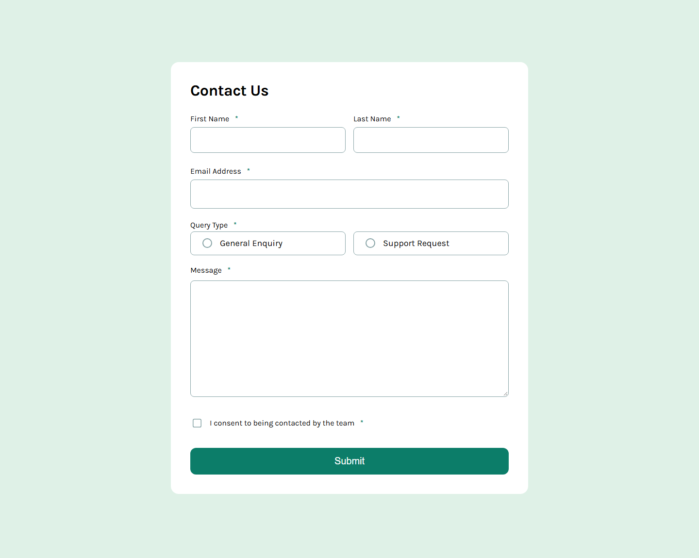
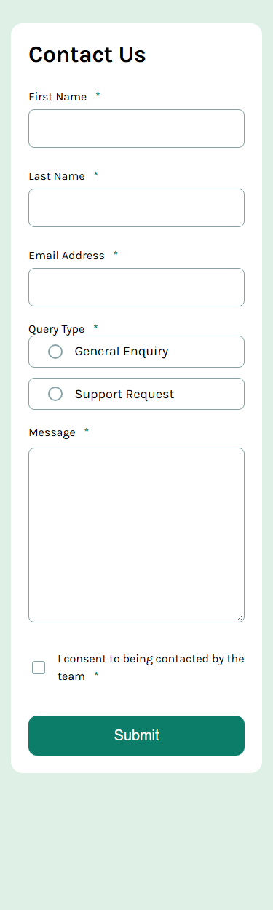

# Frontend Mentor - Contact form

A responsive contact form built for a Frontend Mentor challenge.

## Table of contents

- [Overview](#overview)
- [Screenshots](#screenshots)
- [Links](#links)
- [Built with](#built-with)
- [What I learned](#what-i-learned)
- [Continued development](#continued-development)
- [Local development and checks](#local-development-and-checks)
- [Commit workflow](#commit-workflow)
- [Author](#author)

## Overview

The goal was to reproduce the supplied design while making the form usable on different screen sizes and with a keyboard.

Users can:

- Complete the form with a keyboard and identify the focused control.
- See specific errors for missing fields, malformed email addresses, query type, and consent.
- Move directly to the first invalid field after submitting and correct errors without losing entered values.
- Receive linked field descriptions and a live status update after validation.
- See hover feedback, selected radio states, and a visible completion message.

This is a frontend demo: successful validation resets the form and displays a completion message. It does not send a message to a server.

## Screenshots

These are actual browser captures of the finished local solution, rather than the supplied design previews.

Desktop, 1440px viewport:



Mobile, 375px viewport:



## Links

- [Source repository](https://github.com/pettik/FrontendMentor--contact-form)
- [Live site](https://pettik-contact-form.netlify.app/)

## Built with

- Semantic HTML, including labels, a fieldset, and a legend for the radio group.
- CSS custom properties, Flexbox, and CSS Grid.
- Responsive layouts with a desktop media query.
- Vanilla JavaScript and a shared map of validation messages.
- Native form controls and email validity information, with `novalidate` so JavaScript controls error presentation.
- `aria-describedby`, `aria-invalid`, and a persistent `role="status"` live region.
- Visible focus outlines, hover states, and reduced-motion support for radio transitions.

## What I learned

### BEM and naming

Reviewing BEM helped clarify the difference between a component, one of its parts, and a state. Names such as `.first-name-input` describe a specific field, but repeating that pattern for every field leads to repeated selectors. A shared name such as `.contact-form__input`, with a modifier such as `.contact-form__input--invalid`, would make that relationship clearer.

The current stylesheet still mixes field-specific classes and shared classes such as `.inputs` and `.radio-option`; it is not a complete BEM implementation. A future naming refactor should update HTML, CSS, and JavaScript together so selectors continue to agree.

### Accessible form validation

The most useful lesson was that a visible error is only one part of validation. The message must contain text, the invalid control must reference it, and `aria-invalid` must be cleared when the error is corrected. Both radios need the same group error, while the first invalid control needs focus after an unsuccessful submit.

Native `required` and `type="email"` constraints can stop submission before a custom handler runs. Adding `novalidate` lets the handler present consistent messages while keeping the native controls and required semantics. A shared message map also prevents a missing function argument from producing an empty or `undefined` error.

Announcements need their own update path: the status region exists before submission, and its text is cleared before a new message is inserted so repeated submissions can trigger another update. Hidden errors are only attached with `aria-describedby` when a control is invalid, avoiding premature error descriptions. Verifying the DOM updates is useful, but listening with a real screen reader is still a separate check.

## Continued development

- Apply one BEM naming convention consistently across the whole form.
- Check repeated error and completion announcements with NVDA and VoiceOver.
- Add a real submission endpoint and handle pending, success, and network-error states before using the form in production.

## Local development and checks

No dependency installation or build step is required. Open `index.html` directly, or serve the project from its root:

```sh
python -m http.server 8765 --bind 127.0.0.1
```

Then visit `http://127.0.0.1:8765/`.

Basic source checks:

```sh
node --check assets/js/script.js
git diff --check
```

Browser verification covers empty submissions, whitespace-only values, invalid emails, both query types, missing consent, error correction, reset behavior, and repeated submissions. Responsive checks use widths of 320, 375, 768, and 1440px. Keyboard checks should include Tab, arrow keys within the radio group, Space for consent, and Enter to submit.

## Commit workflow

Group changes by their purpose and describe the resulting behavior in the commit message. Keep validation logic with the HTML attributes it requires, interactive styles in a styling change, and documentation with its screenshots.

Examples:

- `Fix required-field messages and accessible validation state`
- `Add hover feedback and visible keyboard focus`
- `Document the finished form and accessibility lessons`

Before committing, review the staged diff and combine related local edits. Avoid repeated messages such as `Update script.js`; each commit should make sense without opening its diff. Published history is retained rather than rewritten as part of these fixes.

## Author

- Website - [Petr Bednarski](https://github.com/pettik)
- Frontend Mentor - [@pettik](https://www.frontendmentor.io/profile/pettik)
